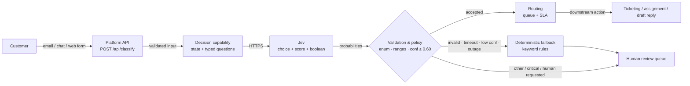

# Architecture

## Request path

```text
┌──────────────┐   email / chat / web form
│   Customer   │────────────────────────────────┐
└──────────────┘                                │
                                                ▼
                                   ┌─────────────────────────┐
                                   │  Platform API (Hono)    │
                                   │  POST /api/classify     │
                                   │  1. auth + rate limit   │
                                   │  2. zod input schema    │
                                   └────────────┬────────────┘
                                                │ validated {message, channel, tier}
                                                ▼
                                   ┌─────────────────────────┐
                                   │ Decision capability     │
                                   │ classify.ts             │
                                   │ builds state + 3        │
                                   │ typed questions         │
                                   └────────────┬────────────┘
                                                │ HTTPS POST (state, questions)
                                                ▼
                                   ┌─────────────────────────┐
                                   │  Jev                    │
                                   │  choice / score / bool  │
                                   │  70–500 ms, no free text│
                                   └────────────┬────────────┘
                                                │ category + confidence
                                                │ urgency score
                                                │ needs_human probability
                                                ▼
                                   ┌─────────────────────────┐
                                   │ Validation + policy     │
                                   │ • label in enum         │
                                   │ • ranges finite         │
                                   │ • confidence ≥ 0.60     │
                                   │ • safety overrides      │
                                   └───────┬─────────────┬───┘
                                           │ accepted    │ rejected / error / timeout
                                           ▼             ▼
                              ┌──────────────────┐  ┌────────────────────────┐
                              │ Routing          │  │ Deterministic fallback │
                              │ queue + SLA      │  │ keyword rules, no model│
                              └────────┬─────────┘  │ needsHuman = true      │
                                       │            └───────────┬────────────┘
                                       ▼                        ▼
                         ┌─────────────────────┐   ┌──────────────────────────┐
                         │ Downstream action   │   │ Human review queue       │
                         │ create ticket,      │   │ general-triage / agent   │
                         │ draft reply, assign │   │                          │
                         └─────────────────────┘   └──────────────────────────┘
```

The model never writes to the database and never sends a reply. It only
produces a typed signal. Authorization, policy, and side effects stay in the
platform.

## Mermaid



## Failure boundaries

| Failure | Detection | Behaviour |
|---|---|---|
| Service down / 5xx | fetch error or non-2xx | fallback, `model_unavailable` |
| Slow model | `AbortSignal.timeout` | fallback, `model_timeout` |
| Rate limit (429) | non-2xx | fallback; evidence harness retries, production alerts |
| Malformed JSON | envelope schema | fallback, `invalid_model_response` |
| Unknown label | enum validation | fallback, `invalid_model_response` |
| Score/confidence out of range | numeric validation | fallback, `invalid_model_response` |
| Low confidence (< 0.60) | policy | fallback, `low_confidence` |
| Category `other` | policy | accept but force human review |
| Critical urgency / model asks for human | policy | force human review |
| Bad request | input schema | HTTP 400, model is never called |
